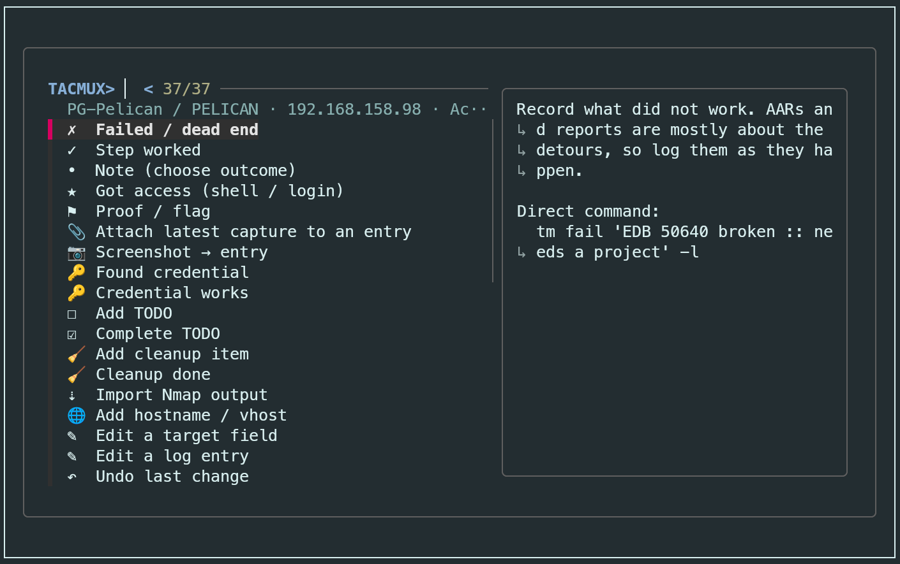
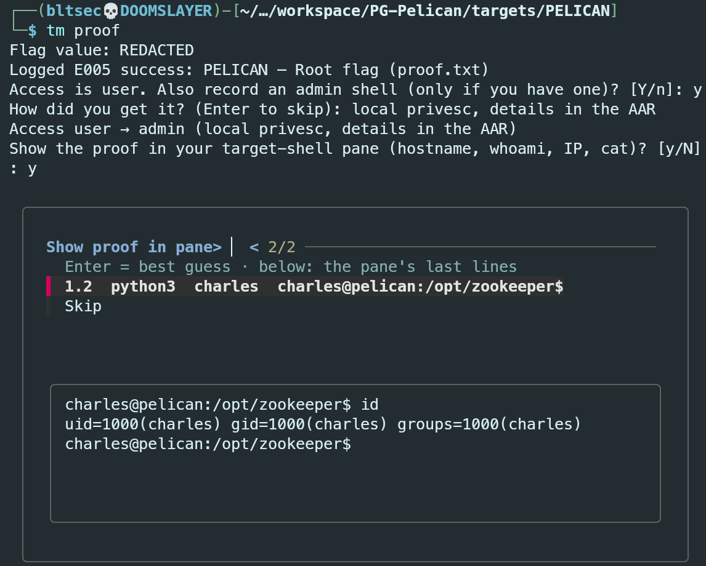
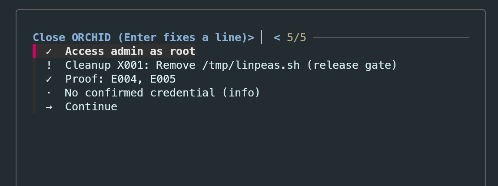
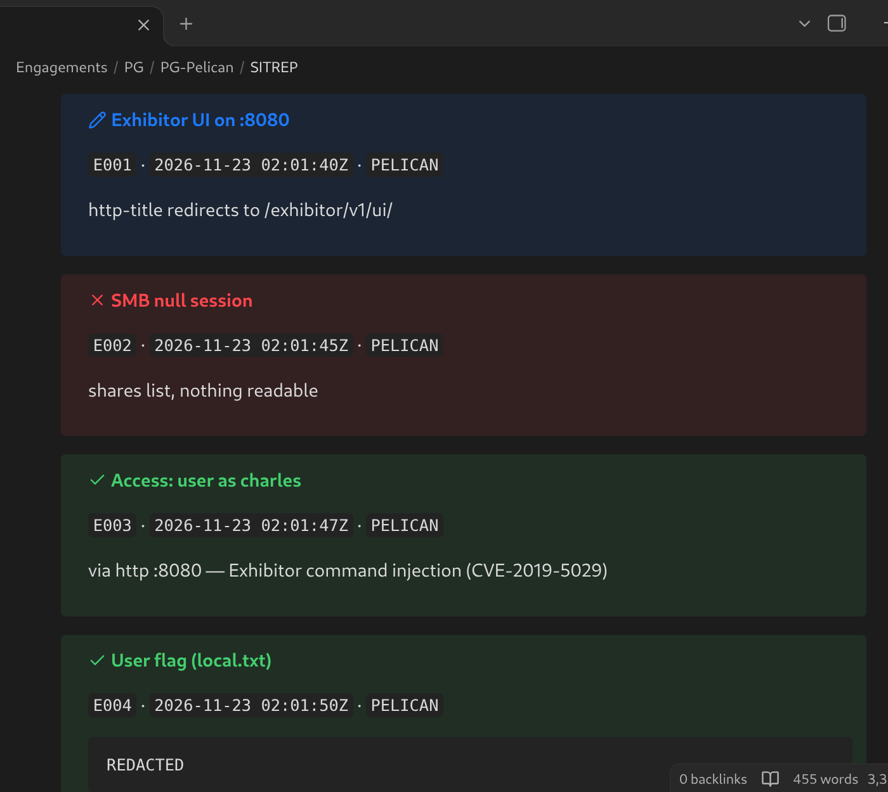

# TACMUX

<p align="center">
  
</p>

<p align="center">
  <a href="https://github.com/BLTSEC/TACMUX/actions/workflows/ci.yml"></a>
  <a href="LICENSE"></a>
</p>

TACMUX is a lean tmux workspace for authorized penetration tests and red-team
operations. Each target gets its own session, every pane is logged, and one
editable `SITREP.md` holds targets, ports, credentials, tasks, cleanup, and an
Operations Log. Recording a dead end, an access level, or a flag takes one key
and a sentence, so it happens while the evidence is still on screen.

> Use TACMUX only with explicit authorization. You remain responsible for scope,
> rules of engagement, testing windows, evidence handling, and retention.

## What it looks like

Shots from a demo box (flags redacted). Full walkthrough:
[bltsec.com/blog/tacmux](https://bltsec.com/blog/tacmux/).

**Prefix+M: one palette for everything you record.** The preview shows the
direct command.



**`tm proof`: asks how you got the access, then types the proof line into the
shell pane you pick.**



**`tm close`: a checklist with cleanup as the release gate.**



**The SITREP in Obsidian: every entry is a callout colored by outcome.**



## Requirements

- Linux, Python 3.11+, tmux, [fzf](https://github.com/junegunn/fzf), and
  [uv](https://docs.astral.sh/uv/) (installer)
- `$VISUAL`, `$EDITOR`, or `vi`
- Optional: Zsh (completion), Nmap (`tm discover nmap`),
  [NOCAP](https://github.com/BLTSEC/NOCAP) 2.3+ (command captures as evidence),
  flameshot (screenshots), and penelope (shell logs copied into captures)

## Install

```bash
git clone --branch v3.4.13 --depth 1 https://github.com/BLTSEC/TACMUX.git
cd TACMUX
./install.sh --workspace ~/workspace   # omit --workspace on reinstall
exec "$SHELL" -l
tacmux health
alias tm='tacmux'                      # add to your shell rc; docs use tm
```

The installer puts TACMUX under `~/.local/share/tacmux`, links `tacmux` into
`~/.local/bin`, and adds one managed block to `~/.zshrc` (completion for
`tacmux` and `tm`, plus the command journal) and one line to `~/.tmux.conf`.
A running tmux server is reloaded for you; otherwise the key bindings load
with the next tmux start.

## Quick start

One box, start to finish (the screenshots above):

```bash
tm init Orchid 192.0.2.10                  # engagement Orchid, target ORCHID; opens its session
nmap -sCV -p- "$TARGET" | tm ports add     # ports into SITREP, OS from Nmap
tm log 'Build console on :8080 :: http-title redirects to /console/'
tm fail 'SMB null session :: shares list, nothing readable'
tm creds add password 'admin:admin'        # C001
tm creds confirm C001 auth 8080            # it works on ORCHID's :8080
tm access user svc_build "command injection in the job runner" --via "http :8080"
tm cleanup add "Remove /tmp/linpeas.sh"
tm proof                                   # flag, path, how you got it, proof in your shell pane
tm evidence                                # every log, command, capture, screenshot
tm close                                   # checklist with cleanup as the release gate
```

In a target session, **Prefix+`M`** (or plain `tm`) opens the palette with all of
these; each entry previews its direct command. **Prefix+`E`** (`tm switch`) jumps
between engagements and targets. More targets: `tm target add WEB01 192.0.2.20`.

Box reverted with a new IP? `tm target update ORCHID endpoint 192.0.2.11` from
OPS offers to save its logs and restart the session, and copies one `/etc/hosts`
command for its hostnames. Scripts and agents (no prompt) run `tm stop ORCHID`
first.

**Leave anything out** and TACMUX asks for just that; Esc cancels without
recording. `tm COMMAND --help` shows exact forms and never writes. Prefixes,
aliases, `Title :: details` entries, `tm undo`, and script mode:
[operator guide](docs/USAGE.md#prompts-shortcuts-and-help).

**Keys** (after your tmux prefix): `M` palette · `E` switcher · `T` toggle pane
logging · `S` save an exact pane capture. An optional status-line badge,
`[ORCHID · user · LOG]`, makes an unrecorded `none` stand out
([three lines of tmux config](docs/KEYBINDINGS.md#status-line-optional)).

## Where things land

```text
~/workspace/Orchid/
├── SITREP.md            # the record (file, or link to sitrep_root)
├── targets.txt          # tm target export: one endpoint per line
├── credentials/         # creds, users, passwords, hashes .txt (from SITREP); keys/
├── captures/            # NOCAP evidence, one folder per target
├── logs/YYYYMMDD/       # raw pane logs (.log) + readable copies (.txt)
├── logs/commands.tsv    # command journal: time, duration, exit, target, pane, cwd, command
├── targets/ORCHID/      # scans/ payloads/ loot/ screenshots/ working/
└── .tacmux/             # engagement marker, lock, undo journal
```

Every command: `tm help`. The SITREP format, evidence, logging, and notes
folders: [operator guide](docs/USAGE.md#logs-evidence-and-closing-out).

## Boundaries and safety

TACMUX does not enforce scope or testing windows, exploit targets, call AI,
generate reports, or keep a findings registry. Draft findings live in
Operations Log entries; formal findings belong to your reporting platform.

The engagement directory holds raw secrets: SITREP, `credentials/`, pane logs,
and the undo journal in `.tacmux/undo/`. Treat all of it as sensitive evidence.
Shared and cloud-synced folders may not enforce Unix permissions. With
`sitrep_root`, back up the physical note and its sibling `images/` directory as
well as the workspace.

## Docs

- [Operator guide](docs/USAGE.md): every workflow in detail; `tm help` in the terminal
- [Keybindings and status line](docs/KEYBINDINGS.md) · [Changelog](CHANGELOG.md) · [Security policy](SECURITY.md)

## Remove

```bash
./uninstall.sh   # configuration and engagement workspaces are preserved
```

## License

[MIT](LICENSE)
